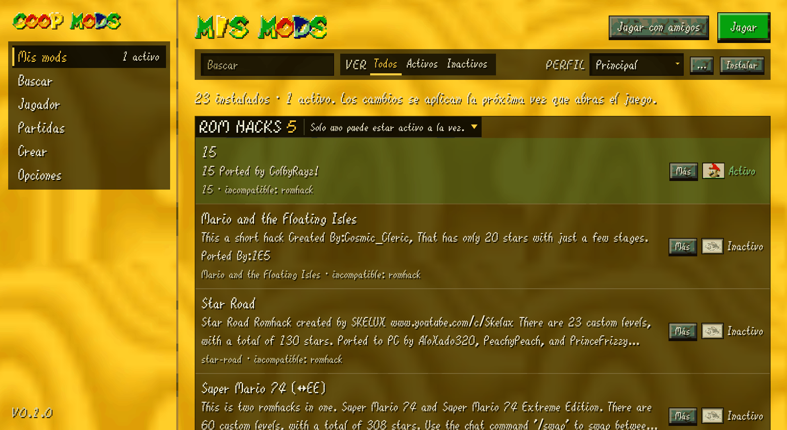
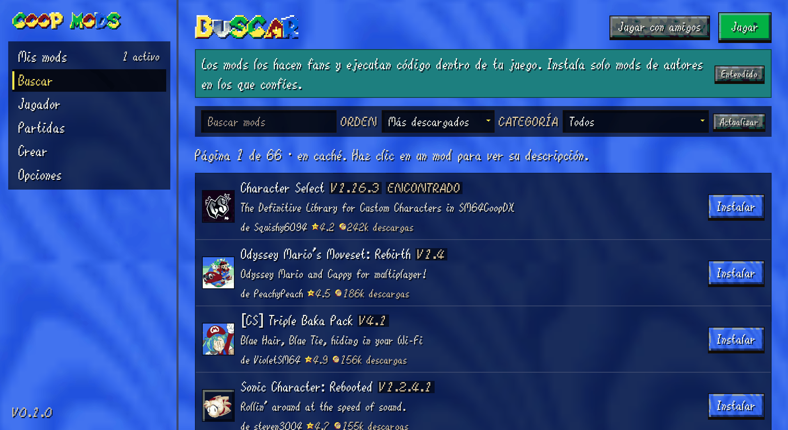
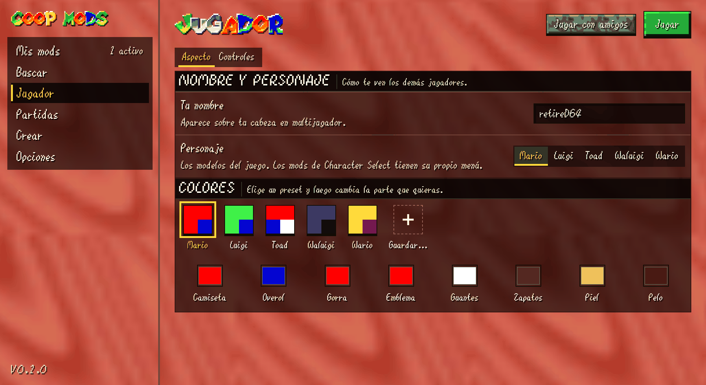
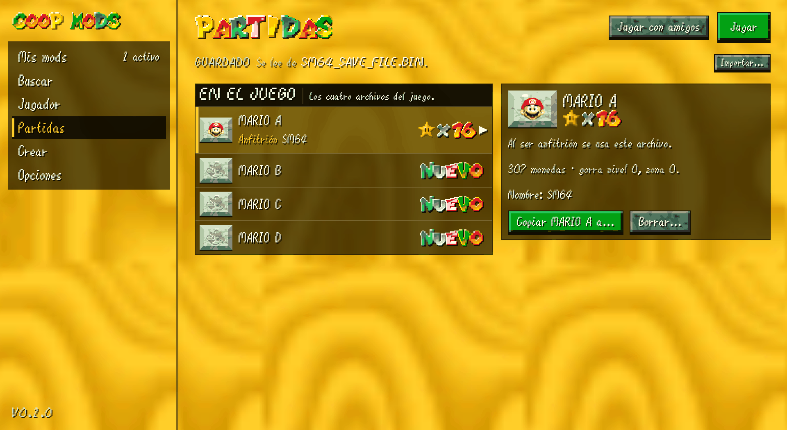
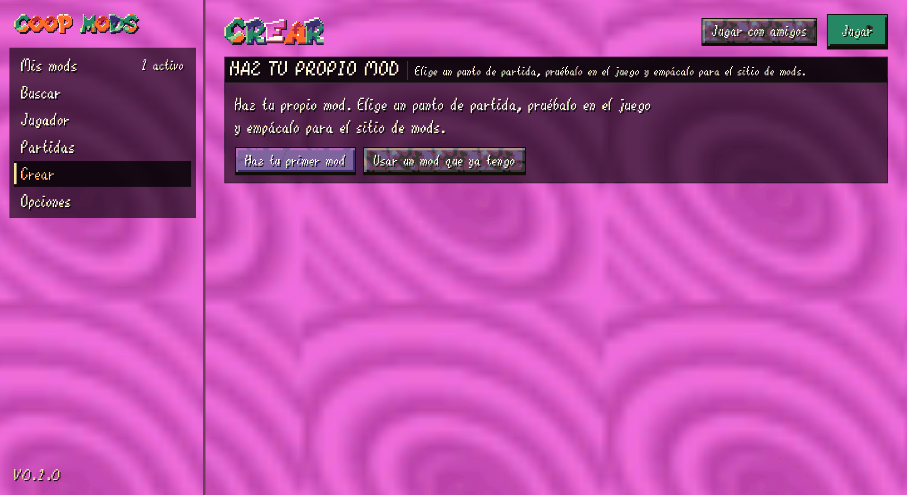
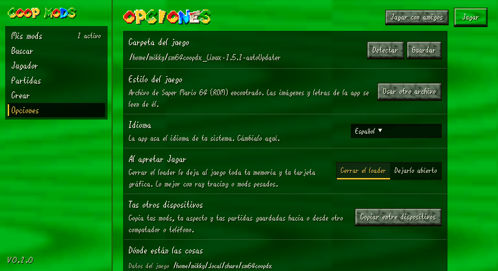
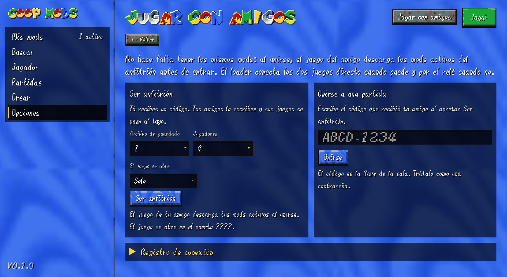
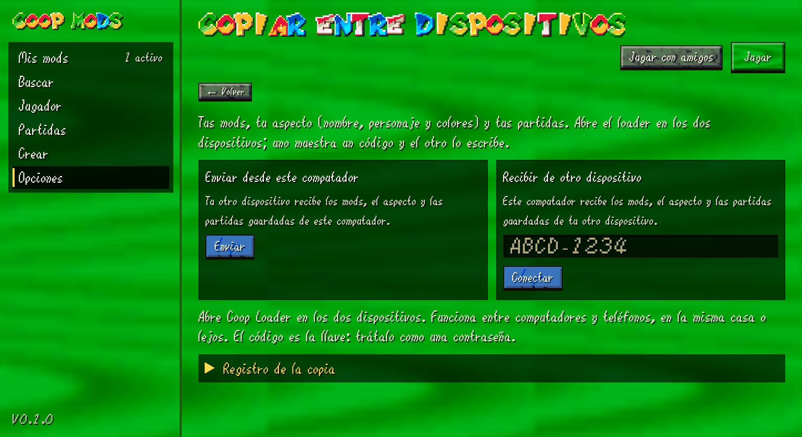

# Coop Loader

Un gestor de mods, partidas y perfiles para **SM64 Coop Deluxe**, escrito en Go.
Un solo binario, sin cgo, con una interfaz web local.

> **Estado:** fases 0–5. Mods, catálogo, dependencias, perfiles, partidas,
> ajustes, **juego online por código** (WebRTC + puente UDP), **copia entre
> dispositivos** (mods, aspecto y partidas) y **el aspecto del juego leído de tu
> ROM** (texturas, letras, títulos y botones) funcionan. El visor 3D del
> personaje es la siguiente fase.

[English summary](#english-summary) · [Arquitectura](docs/ARCHITECTURE.md) · [Aspecto desde la ROM](docs/THEME.md) · [Protocolo](docs/PROTOCOL.md) · [Motor de sesión](docs/SESSION.md) · [Sincronización de mods](docs/MOD_SYNC.md) · [Copia](docs/COPY.md)

---

## Qué hace hoy

| Función | Estado |
|---|---|
| Detectar el juego (Linux, Windows, macOS) | ✅ |
| Listar mods y packs DynOS (usuario + integrados) | ✅ |
| Activar/desactivar mods en `sm64config.txt` | ✅ |
| Copias de seguridad del config y escritura atómica | ✅ |
| Perfiles de mods | ✅ |
| Instalar `.zip`, `.lua`, `.luac` con validación | ✅ |
| Detección de Lua compilado y confirmación | ✅ |
| Quitar mods sin borrarlos (`removed-by-coop-loader`) | ✅ |
| Leer/escribir la partida de 512 bytes (4 slots) | ✅ |
| Copiar, borrar e importar partidas | ✅ |
| Catálogo del sitio: buscar, filtrar, ordenar, paginar | ✅ |
| Instalar desde el sitio + actualizar + procedencia | ✅ |
| Dependencias Lua: quién provee `_G.X` y qué falta | ✅ |
| Interfaz web local con token | ✅ |
| Sesión P2P por código (WebRTC + puente UDP 7777) | ✅ |
| Reconexión con retención del lugar (`STILL_HERE`) | ✅ |
| Consentimiento, ruta directa/relé y registro de conexión | ✅ |
| Sincronización de mods del anfitrión al unirse (la hace el juego) | ✅ |
| Copia de mods/aspecto/partidas por código (`copy/v1`) | ✅ |
| Tema visual desde la ROM (texturas, fuentes, títulos, botones) | ✅ |
| Jugador: nombre, personaje, colores y presets | ✅ |
| Opciones al estilo original (filas con título, descripción y control) | ✅ |
| Transiciones de pantalla, botones, hover y detalles de mods | ✅ |
| Visor 3D del personaje | ⏳ fase 6 |

## Vista

El tema, las letras y los iconos salen de tu propia ROM. Las capturas los
muestran con una ROM del autor; el repositorio no incluye los archivos de
textura ni las fuentes extraídas.

| Mis mods | Buscar |
|---|---|
|  |  |

| Jugador | Partidas |
|---|---|
|  |  |

| Crear | Opciones |
|---|---|
|  |  |

| Jugar con amigos | Copiar entre dispositivos |
|---|---|
|  |  |

## Empezar

Necesitas **Go 1.25 o superior**. Las dependencias (`goquery` para el sitio,
`pion/webrtc` para las conexiones y `coder/websocket` para los trackers) las
baja `go build` solo. No hay cgo ni bibliotecas del sistema.

```bash
git clone https://github.com/retired64/coop-loader
cd coop-loader
go build -o coop-loader ./cmd/coop-loader
./coop-loader
```

Se abre `http://127.0.0.1:8787/?token=…`. El token es distinto en cada arranque:
sin él, la API responde 401, así que una página cualquiera no puede manejar tus mods.

Si no detecta el juego, elígelo en **Opciones** o pásalo por CLI:

```bash
./coop-loader game set "/ruta/a/sm64coopdx"
./coop-loader game detect
```

## Probar sin riesgo

**Contra tu instalación real** (solo lee hasta que pulses un interruptor):

```bash
./coop-loader status      # rutas, si el juego está abierto, config y save
./coop-loader mods list   # qué mods ve y cuáles están activos
./coop-loader saves list  # estrellas, monedas y nombres de tus 4 slots
./coop-loader             # abre la interfaz
```

Si algo sale mal, todo es reversible:

```bash
# volver al config anterior
cp ~/.local/share/sm64coopdx/sm64config.modloader-backup.txt \
   ~/.local/share/sm64coopdx/sm64config.txt

# los mods quitados siguen aquí
ls ~/.local/share/sm64coopdx/removed-by-coop-loader/
```

**En un entorno de mentira**, sin tocar nada tuyo:

```bash
DEMO=/tmp/coop-loader-demo
rm -rf "$DEMO" && mkdir -p "$DEMO"/{home,config,data}
export HOME="$DEMO/home" XDG_CONFIG_HOME="$DEMO/config" XDG_DATA_HOME="$DEMO/data"

mkdir -p "$DEMO/home/Games/sm64coopdx/mods/Example" "$XDG_DATA_HOME/sm64coopdx"
printf '#!/bin/sh\n' > "$DEMO/home/Games/sm64coopdx/sm64coopdx"
chmod +x "$DEMO/home/Games/sm64coopdx/sm64coopdx"
printf -- '-- name: Example Mod\n' > "$DEMO/home/Games/sm64coopdx/mods/Example/main.lua"
printf 'sound = 1\n' > "$XDG_DATA_HOME/sm64coopdx/sm64config.txt"

./coop-loader
```

Ahí puedes instalar un zip, activar mods, crear perfiles y probar el save sin
miedo. Cuando cierres la terminal, tus datos reales siguen intactos.

La pestaña **Buscar** sí usa Internet (lee el sitio de mods), pero no descarga
nada hasta que pulsas *Instalar*. La caché vive en el `XDG_CONFIG_HOME` del
entorno de prueba.

## Jugar con amigos (fase 3)

En **Jugar con amigos** hay dos caminos:

1. **Ser anfitrión.** El loader crea un código `ABCD-1234`, lo copia al
   portapapeles y se queda esperando en los puntos de encuentro.
2. **Unirse a una partida.** El amigo escribe el código. Los dos clientes
   derivan la misma sala con PBKDF2 y se encuentran sin abrir puertos en el router.

Cuando la sesión dice **Conectado**, cualquiera de los dos pulsa **Abrir el
juego**. En el juego hay que elegir **Direct Connection**:

- anfitrión: **Host → Direct Connection → Host**;
- amigo: **Join → Direct Connection → Join** con `localhost` o `127.0.0.1`.

El aviso de *port forwarding* se ignora: el puente UDP hace ese trabajo.

**No hace falta tener los mismos mods instalados.** Al unirse, el juego del
amigo pide la lista de mods activos del anfitrión y descarga los que le falten
en una carpeta temporal propia (`.tmp/<sesión>/`), antes de entrar a la partida.
Si ya tiene el mismo archivo (mismo MD5), lo reutiliza. Los mods del amigo que
no estén activos en el anfitrión no se usan durante esa sesión. El loader no
interviene en esa transferencia: solo transporta los datagramas del juego. Está
explicado con el código del juego en [docs/MOD_SYNC.md](docs/MOD_SYNC.md).

> **Ojo:** el anfitrión te envía Lua y tu juego lo ejecuta. Únete solo a
> personas de confianza.

Puntos importantes:

- **El código es la contraseña.** Son 40 bits; no lo publiques ni lo reutilices
  para varias partidas.
- **Se pide consentimiento la primera vez**, porque la IP se comparte con los
  trackers públicos, el relay y los servidores STUN.
- **Ruta directa o relay.** La UI muestra `direct` o `relay` por amigo. Si la
  red no permite el P2P, el tráfico pasa por el relay de Cloudflare.
- **Reconexión con retención.** Si el enlace se cae, el juego sigue recibiendo
  `STILL_HERE` durante un minuto y los paquetes de estado se reenvían al volver.
- **Abrir solo cuando haga falta.** Se puede elegir que el juego se abra solo
  cuando el amigo aparece, o abrirlo a mano.
- **Relay propio.** `COOP_RELAY_URL=https://tu-worker` cambia el punto de
  encuentro; `COOP_NO_TRACKERS=1` desactiva los cuatro trackers públicos.

El protocolo exacto, los temporizadores y la máquina de estados están en
[docs/SESSION.md](docs/SESSION.md). El contrato de red, en
[docs/PROTOCOL.md](docs/PROTOCOL.md).

## Copiar entre dispositivos (fase 4)

La pestaña **Copiar entre dispositivos** mueve los mods, el aspecto del jugador
(nombre, personaje y colores) y las partidas entre dos computadores o teléfonos.
No hace falta estar en la misma red: usa los mismos puntos de encuentro que
**Jugar con amigos**.

1. En un dispositivo: **Copiar entre dispositivos → Enviar desde este
   computador**. Aparece un código.
2. En el otro: **Copiar entre dispositivos → Recibir de otro dispositivo**,
   escribe el código.
3. El receptor revisa qué va a copiar. Puede desmarcar **Mods**, **Aspecto** o
   **Partidas**.
4. **Copiar a este computador**. Se ve el progreso y, al terminar, **Listo**.

Qué hay que saber:

- **Es distinto de unirse a una partida.** Al jugar, el juego ya sincroniza los
  mods activos del anfitrión (ver [MOD_SYNC.md](docs/MOD_SYNC.md)). **Copiar** sirve
  para preinstalar mods, mover el aspecto y llevar las partidas a otro
  dispositivo, incluso sin abrir el juego.
- **Lo reemplazado no se borra.** Mods, paletas, partidas y `.sav` van a
  `removed-by-coop-loader/copy-<fecha>/`; `sm64config.txt` guarda su propia
  copia (`sm64config.modloader-backup.txt`).
- **SHA-256 por archivo.** Si un archivo llega dañado, no se aplica nada.
- **El código es la contraseña.** Son 40 bits; no lo publiques ni lo reutilices.
- **Solo entre dispositivos de confianza.** Los mods incluyen Lua y el otro
  dispositivo lo ejecutará.
- **El juego debe estar cerrado.** Al cerrarse reescribe su configuración y
  desharía la copia. Tampoco se puede copiar mientras juegas con un amigo, ni
  jugar mientras copias.

El protocolo exacto (roles, manifiesto, frames, ventana, ACKs y reglas de
aplicación) está en [docs/COPY.md](docs/COPY.md).

## El aspecto del juego (fase 5)

La interfaz usa la **ROM de Super Mario 64 (USA)** que ya tienes para
`sm64coopdx`. No se incluye ningún recurso de Nintendo: el loader lee la ROM en
tu máquina y guarda el resultado en su caché.

- **Fondo de cada pestaña**: las maderas del juego (amarillo en Mis mods,
  Partidas y Perfiles; azul en Buscar; rojo en Jugador; rosa en Crear; verde en
  Opciones y Copiar). El **menú lateral usa la misma madera que la pestaña
  activa**, así cambia de color junto con la pantalla.
- **Títulos y logotipo**: las letras del HUD, cada una con su color, como
  `MIS MODS` u `OPCIONES`.
- **Texto**: la fuente de diálogo del juego; las etiquetas usan la fuente de
  menú.
- **Botones**: mármol oscuro, madera verde para Jugar, azul para instalar y roja
  para borrar.
- **Partidas**: caras de Mario, iconos de estrella y el rótulo `NUEVO`.
- **Jugador**: nombre, personaje, ocho colores y presets leídos de
  `sm64config.txt` y de las carpetas `palettes/`.
- **Opciones**: filas grandes como el cliente original, con título, descripción
  y el control a la derecha; el ajuste de Jugar usa un selector de dos botones.
- **Buscar**: lista de mods con icono, título, descripción, autor, valoración y
  descargas; toda la fila abre la ficha del mod y el botón Instalar queda a la
  derecha.
- **Movimiento**: transiciones de pantalla con barrido, letras que entran y
  salen, marcador deslizante en la barra lateral, botones que se levantan y se
  hunden y filas que reaccionan al ratón.

En **Opciones → Estilo del juego → Usar otro archivo** eliges la ROM. También se
busca sola en `<datos del juego>/baserom.us.z64` y en la carpeta del juego. Se
valida el SHA-1 de la USA 1.0 antes de leer nada.

Si no hay ROM, la app sigue funcionando con un tema sobrio y texto normal; no se
rompe nada. La extracción, los offsets y las decisiones están en
[docs/THEME.md](docs/THEME.md).

## Catálogo y dependencias

La pestaña **Buscar** lee el sitio `mods.sm64coopdx.com`. Como el sitio no tiene
API, el loader descarga el HTML y lo interpreta:

- **Caché** de una hora en `~/.config/coop-loader/site-cache.json`.
- **800 ms entre peticiones** al sitio, con un User-Agent propio.
- **Descargas** solo desde el sitio; si el botón lleva a GitHub se resuelve la
  release (con confirmación). Cualquier otro host se abre en el navegador, nunca
  se descarga a ciegas.
- **Procedencia**: `installed.json` guarda de qué ficha y versión vino cada mod,
  así que la lista marca **Instalado** o **Actualizar**.
- **Dependencias**: el loader escanea el Lua del mod (sin ejecutarlo) buscando
  `_G.Algo` que necesite, y los globales que proveen los mods instalados. Si
  falta uno, ofrece activar el mod que lo provee o instalarlo desde el sitio.

Todo se instala con las mismas garantías que un zip local: límites de tamaño,
protección contra `zip-slip`, aviso si trae Lua compilado y el juego cerrado.

## CLI

```bash
coop-loader status
coop-loader mods list
coop-loader mods on CharacterSelect
coop-loader mods off Romhack.lua
coop-loader mods install ~/Downloads/mod.zip
coop-loader mods remove OldMod
coop-loader saves list
coop-loader saves copy A C
coop-loader saves import ~/Downloads/sm64_save_file.bin
coop-loader profiles list
coop-loader profiles create "Sin mods"
coop-loader profiles switch Default
```

## Dónde guarda las cosas

Respeta las carpetas que usa el propio juego:

| Sistema | Datos del juego |
|---|---|
| Linux | `$XDG_DATA_HOME/sm64coopdx` o `~/.local/share/sm64coopdx` |
| Windows | `%APPDATA%\sm64coopdx` |
| macOS | `~/Library/Application Support/sm64coopdx` |

Ahí viven `mods/`, `dynos/packs/`, `palettes/`, `sm64config.txt` y
`sm64_save_file.bin`. El loader guarda sus ajustes, perfiles, procedencia del
sitio y el consentimiento online en `<config>/coop-loader/`.

## Seguridad de los datos

Tres reglas que el código respeta en todas las escrituras:

1. **Nunca escribir con el juego abierto.** sm64coopdx reescribe su config al
   salir y desharía el cambio.
2. **Nunca sobrescribir a ciegas.** `sm64config.txt` se respalda una vez por
   sesión; la partida también. Todo se escribe con archivo temporal + `rename`.
3. **Nunca borrar.** Lo que se quita va a `removed-by-coop-loader/` y se puede
   recuperar.

Además, al instalar: se rechazan rutas que escapan (`zip-slip`), se limitan
20 000 entradas y 2 GiB, y se pide confirmación si el mod trae Lua compilado.

En la sesión online no se escribe nada del juego: el loader solo abre sockets
loopback y mueve datagramas. Antes de lanzar como anfitrión guarda
`coop_host_save_slot` y `coop_host_port` en `sm64config.txt`, con la misma
escritura atómica y la misma copia de seguridad.

## Diseño

- **Go, sin cgo.** El núcleo usa solo la biblioteca estándar; el catálogo añade
  `goquery`, y la sesión `pion/webrtc` y `coder/websocket`. Nada de cgo, así que
  el binario compila en cualquier SO sin bibliotecas del sistema.
- **El núcleo no sabe de HTTP.** `internal/app` expone el estado y las
  operaciones; `internal/server` solo lo traduce a JSON. Mañana puede ser una
  ventana nativa (Wails) o una app Android sin tocar el núcleo.
- **La UI es HTML/CSS/JS sin build.** Se sirve desde `embed.FS`; para cambiarla
  basta editar `internal/server/web/`.
- **Todo lo binario está documentado y testeado** (`sm64config.txt`, la EEPROM
  de 512 bytes, el enrutado de zips y el protocolo de la sesión).
- **La red no vive en la UI.** `internal/session` tiene su propia máquina de
  estados y se prueba con un relay local y sockets UDP falsos; la UI solo pinta
  lo que devuelve `/api/session/state`.

```
cmd/coop-loader      CLI + servidor
internal/app         casos de uso (estado, guardas, perfiles, catálogo)
internal/catalog     sitio de mods: HTML, caché, descargas, GitHub
internal/deps        escaneo de globales Lua y emparejamiento de nombres
internal/installed   procedencia y versión de los mods instalados
internal/session     código de sala, señalización, WebRTC y puente UDP
internal/devicecopy  copy/v1: manifiesto, frames, SHA-256 y staging
internal/rom         ROM USA: MIO0, texturas, fuentes, HUD y nombres
internal/conf        sm64config.txt y perfiles
internal/eeprom      partida de 512 bytes
internal/mods        descubrimiento, metadatos, instalación, borrado
internal/game        detección, proceso, lanzamiento
internal/server      API local + UI embebida
internal/fsutil      escrituras atómicas, rutas seguras
internal/paths       rutas por sistema operativo
internal/settings    settings.json
```

Detalles y decisiones en [docs/ARCHITECTURE.md](docs/ARCHITECTURE.md).

## Tests

```bash
go test ./...
go vet ./...
```

Cubren lo que puede corromper datos o traer código de fuera: reescritura del
config preservando CRLF, `enable-mod`/`dynos-pack`, checksum y endianness de la
partida, rutas de instalación y `zip-slip`, bytecode, parseo del sitio con
fixtures HTML, caché en disco, descargas (adjunto/elección/externo), GitHub,
escaneo de globales Lua, la resolución de dependencias, el vector PBKDF2, el
cifrado de SDP, el puente UDP (host/join, `STILL_HERE`, caché y reenvío), una
partida completa host↔join contra un relay WebSocket local, y la copia
`copy/v1` (manifiesto, rutas seguras, SHA-256, archivos vacíos y grandes,
staging, configuración, paletas, partida y `.sav`), el jugador y sus presets, y
la extracción de la ROM (16 texturas, 50 dibujos del HUD, dos fuentes y los
nombres de niveles) contra una extracción de referencia.

## Roadmap

| Fase | Contenido |
|---|---|
| 0–1 | núcleo local: mods, config, perfiles, partidas, UI | ✅ |
| 2 | catálogo del sitio + descargas + dependencias Lua | ✅ |
| 3 | sesión por código: PBKDF2/AES-GCM, trackers, `pion/webrtc`, puente UDP 7777, reconexión | ✅ |
| 4 | copia de mods/aspecto/partidas entre PC y Android (`copy/v1`) | ✅ |
| 5 | tema visual, fuentes y títulos desde la ROM del usuario | ✅ |
| 6 | visor 3D del personaje leyendo el ejecutable del juego |
| 7 | creador de mods completo, test headless, empaquetado, updater firmado |

La fase 3 está explicada a fondo en [docs/SESSION.md](docs/SESSION.md), la fase
4 en [docs/COPY.md](docs/COPY.md) y la fase 5 en [docs/THEME.md](docs/THEME.md);
el contrato de red de las fases 3 y 4, en [docs/PROTOCOL.md](docs/PROTOCOL.md).

## Sobre este proyecto

Es una **reimplementación limpia** (clean-room) basada en el comportamiento
observable del juego y de su ecosistema. **No contiene código, textos ni
recursos del Coop Mod Loader original de Jehu**, ni de Nintendo. No está
afiliado a Nintendo ni al equipo de sm64coopdx.

No se incluye ninguna ROM, modelo, textura ni fuente del juego: la app lee tus
propios archivos y los usa en tu máquina. Los mods los crea la comunidad y
ejecutan código dentro del juego: instala solo lo que confíes.

## Licencia

MIT. El titular actual es `Retired64`; cámbialo en [LICENSE](LICENSE) si publicas
bajo otra cuenta.

---

## English summary

A clean-room **Go** mod manager for SM64 Coop Deluxe: local single binary with an
embedded web UI. Phases 0–5 cover game detection, mod discovery and installation
(zip/lua), `sm64config.txt` editing with backups, profiles, the 512-byte save
file, the community mod catalog (browse/search/install/update), Lua global
dependency resolution, and **online play by code** with a WebRTC DataChannel
and a loopback UDP bridge. Sessions reconnect with ICE restart, relay fallback
and a one-minute "hold their place" cache. Joining players do **not** need the
host's mods preinstalled: the game itself transfers the host's active mod set
and the joining client caches the missing files under `.tmp/<session>/` before
entering.

The interface borrows its look from the player's own Super Mario 64 (USA) ROM:
wood backgrounds per tab, HUD lettering for titles, the dialog and menu bitmap
fonts, marble buttons, Mario faces and star icons. Nothing is bundled; the ROM
is read and verified locally and the extracted cache can be deleted at any time.
The player tab edits the name, character, eight colours and palette presets.

Device-to-device copy (`copy/v1`) moves mods, player look and saves over a
separate encrypted DataChannel; it is a convenience for migrating devices, not a
requirement for joining. The session engine is documented in
[docs/SESSION.md](docs/SESSION.md), the copy channel in
[docs/COPY.md](docs/COPY.md), the ROM theme in
[docs/THEME.md](docs/THEME.md), and the wire contract in
[docs/PROTOCOL.md](docs/PROTOCOL.md). Not affiliated with Nintendo or the sm64coopdx
team; no game assets are bundled.
