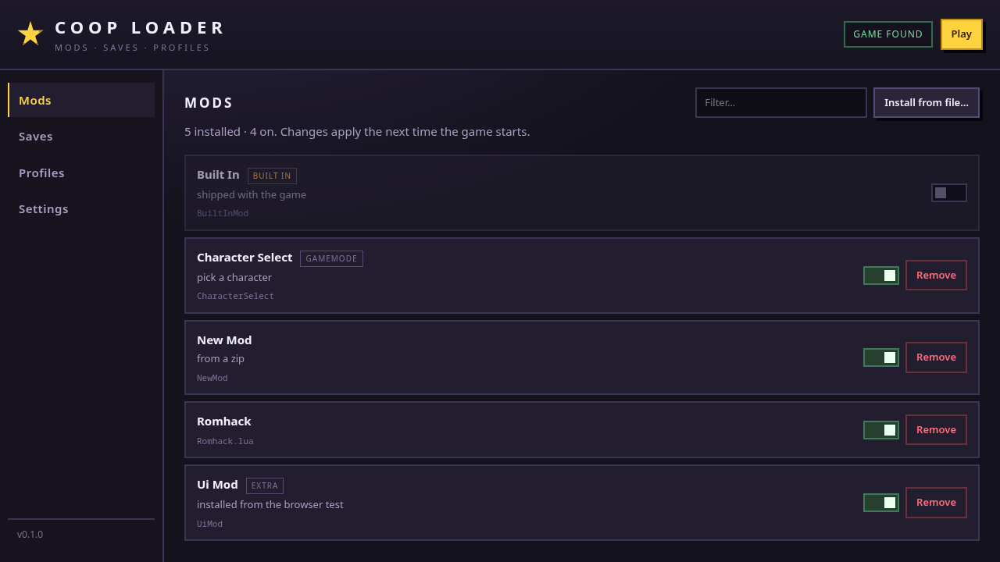
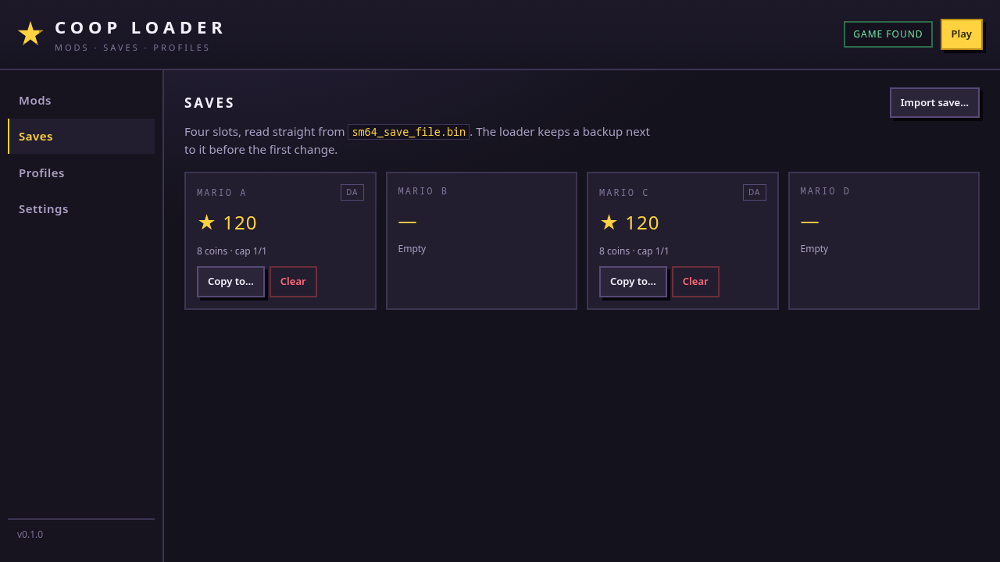

# Coop Loader

Un gestor de mods, partidas y perfiles para **SM64 Coop Deluxe**, escrito en Go.
Un solo binario, sin dependencias externas, con una interfaz web local.

> **Estado:** fases 0–1. Mods, activación, perfiles, partidas y ajustes funcionan.
> La sesión P2P (WebRTC) y la copia entre dispositivos son la siguiente fase.

[English summary](#english-summary) · [Arquitectura](docs/ARCHITECTURE.md) · [Protocolo](docs/PROTOCOL.md)

---

## Qué hace hoy

| Función | Estado |
|---|---|
| Detectar el juego (Linux, Windows, macOS) | ✅ |
| Listar mods y packs DynOS (usuario + integrados) | ✅ |
| Activar/desactivar mods en `sm64config.txt` | ✅ |
| Copias de seguridad del config y escritura atómica | ✅ |
| Perfiles de mods | ✅ |
| Instalar `.zip`, `.lua`, `.luac` con validación | ✅ |
| Detección de Lua compilado y confirmación | ✅ |
| Quitar mods sin borrarlos (`removed-by-coop-loader`) | ✅ |
| Leer/escribir la partida de 512 bytes (4 slots) | ✅ |
| Copiar, borrar e importar partidas | ✅ |
| Interfaz web local con token | ✅ |
| Catálogo del sitio de mods + descargas | ⏳ fase 2 |
| Sesión P2P por código (WebRTC + puente UDP) | ⏳ fase 3 |
| Copia de mods/aspecto/partidas entre dispositivos | ⏳ fase 4 |
| Tema visual desde la ROM + visor 3D | ⏳ fase 5 |

## Vista

| Mods | Partidas |
|---|---|
|  |  |

## Empezar

Necesitas **Go 1.24 o superior**. No hay dependencias que descargar.

```bash
git clone https://github.com/retired64/coop-loader
cd coop-loader
go build -o coop-loader ./cmd/coop-loader
./coop-loader
```

Se abre `http://127.0.0.1:8787/?token=…`. El token es distinto en cada arranque:
sin él, la API responde 401, así que una página cualquiera no puede manejar tus mods.

Si no detecta el juego, elígelo en **Settings** o pásalo por CLI:

```bash
./coop-loader game set "/ruta/a/sm64coopdx"
./coop-loader game detect
```

## CLI

```bash
coop-loader status
coop-loader mods list
coop-loader mods on CharacterSelect
coop-loader mods off Romhack.lua
coop-loader mods install ~/Downloads/mod.zip
coop-loader mods remove OldMod
coop-loader saves list
coop-loader saves copy A C
coop-loader saves import ~/Downloads/sm64_save_file.bin
coop-loader profiles list
coop-loader profiles create "Sin mods"
coop-loader profiles switch Default
```

## Dónde guarda las cosas

Respeta las carpetas que usa el propio juego:

| Sistema | Datos del juego |
|---|---|
| Linux | `$XDG_DATA_HOME/sm64coopdx` o `~/.local/share/sm64coopdx` |
| Windows | `%APPDATA%\sm64coopdx` |
| macOS | `~/Library/Application Support/sm64coopdx` |

Ahí viven `mods/`, `dynos/packs/`, `palettes/`, `sm64config.txt` y
`sm64_save_file.bin`. El loader guarda sus ajustes y perfiles en
`<config>/coop-loader/`.

## Seguridad de los datos

Tres reglas que el código respeta en todas las escrituras:

1. **Nunca escribir con el juego abierto.** sm64coopdx reescribe su config al
   salir y desharía el cambio.
2. **Nunca sobrescribir a ciegas.** `sm64config.txt` se respalda una vez por
   sesión; la partida también. Todo se escribe con archivo temporal + `rename`.
3. **Nunca borrar.** Lo que se quita va a `removed-by-coop-loader/` y se puede
   recuperar.

Además, al instalar: se rechazan rutas que escapan (`zip-slip`), se limitan
20 000 entradas y 2 GiB, y se pide confirmación si el mod trae Lua compilado.

## Diseño

- **Go puro, cero dependencias.** `archive/zip`, `encoding/binary`, `net/http`,
  `embed`. Nada de cgo, lo que hace el binario fácil de compilar en cualquier SO.
- **El núcleo no sabe de HTTP.** `internal/app` expone el estado y las
  operaciones; `internal/server` solo lo traduce a JSON. Mañana puede ser una
  ventana nativa (Wails) o una app Android sin tocar el núcleo.
- **La UI es HTML/CSS/JS sin build.** Se sirve desde `embed.FS`; para cambiarla
  basta editar `internal/server/web/`.
- **Todo lo binario está documentado y testeado** (`sm64config.txt`, la EEPROM
  de 512 bytes, el enrutado de zips).

```
cmd/coop-loader      CLI + servidor
internal/app         casos de uso (estado, guardas, perfiles)
internal/conf        sm64config.txt y perfiles
internal/eeprom      partida de 512 bytes
internal/mods        descubrimiento, metadatos, instalación, borrado
internal/game        detección, proceso, lanzamiento
internal/server      API local + UI embebida
internal/fsutil      escrituras atómicas, rutas seguras
internal/paths       rutas por sistema operativo
internal/settings    settings.json
```

Detalles y decisiones en [docs/ARCHITECTURE.md](docs/ARCHITECTURE.md).

## Tests

```bash
go test ./...
go vet ./...
```

Cubren lo que puede corromper datos: reescritura del config preservando CRLF,
gramática de `enable-mod`/`dynos-pack`, checksum y endianness de la partida,
rutas de instalación de zips y rechazo de `zip-slip`/bytecode.

## Roadmap

| Fase | Contenido |
|---|---|
| 1 | catálogo del sitio + descargas + dependencias Lua |
| 2 | sesión por código: PBKDF2/AES-GCM, trackers, `pion/webrtc`, puente UDP 7777, reconexión |
| 3 | copia de mods/aspecto/partidas entre PC y Android |
| 4 | tema visual y fuentes desde la ROM del usuario |
| 5 | visor 3D del personaje leyendo el ejecutable del juego |
| 6 | creador de mods, test headless, empaquetado, updater firmado |

La fase 2 está especificada, byte a byte, en [docs/PROTOCOL.md](docs/PROTOCOL.md).

## Sobre este proyecto

Es una **reimplementación limpia** (clean-room) basada en el comportamiento
observable del juego y de su ecosistema. **No contiene código, textos ni
recursos del Coop Mod Loader original de Jehu**, ni de Nintendo. No está
afiliado a Nintendo ni al equipo de sm64coopdx.

No se incluye ninguna ROM, modelo, textura ni fuente del juego: la app lee tus
propios archivos y los usa en tu máquina. Los mods los crea la comunidad y
ejecutan código dentro del juego: instala solo lo que confíes.

## Licencia

MIT. El titular actual es `Retired64`; cámbialo en [LICENSE](LICENSE) si publicas
bajo otra cuenta.

---

## English summary

A clean-room **Go** mod manager for SM64 Coop Deluxe: local single binary, no
third-party dependencies, embedded web UI. Phase 0–1 covers game detection, mod
discovery/installation (zip/lua), `sm64config.txt` editing with backups,
profiles, and the 512-byte save file (read, copy, clear, import).

The P2P session engine (WebRTC DataChannel + loopback UDP bridge) and the
device-to-device copy are specified in [docs/PROTOCOL.md](docs/PROTOCOL.md) and
planned for the next phases. Not affiliated with Nintendo or the sm64coopdx
team; no game assets are bundled.
