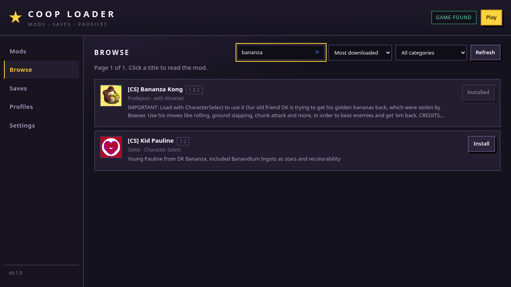
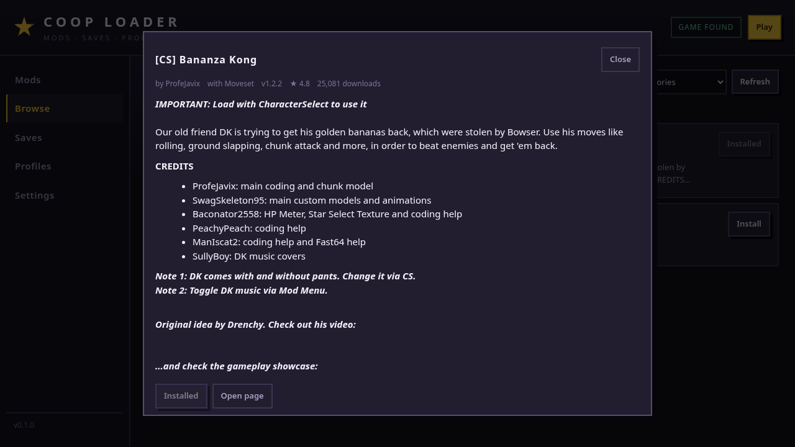

# Coop Loader

Un gestor de mods, partidas y perfiles para **SM64 Coop Deluxe**, escrito en Go.
Un solo binario, sin cgo, con una interfaz web local.

> **Estado:** fases 0–2. Mods, catálogo, descargas, dependencias, perfiles,
> partidas y ajustes funcionan. La sesión P2P (WebRTC) es la siguiente fase.

[English summary](#english-summary) · [Arquitectura](docs/ARCHITECTURE.md) · [Protocolo](docs/PROTOCOL.md)

---

## Qué hace hoy

| Función | Estado |
|---|---|
| Detectar el juego (Linux, Windows, macOS) | ✅ |
| Listar mods y packs DynOS (usuario + integrados) | ✅ |
| Activar/desactivar mods en `sm64config.txt` | ✅ |
| Copias de seguridad del config y escritura atómica | ✅ |
| Perfiles de mods | ✅ |
| Instalar `.zip`, `.lua`, `.luac` con validación | ✅ |
| Detección de Lua compilado y confirmación | ✅ |
| Quitar mods sin borrarlos (`removed-by-coop-loader`) | ✅ |
| Leer/escribir la partida de 512 bytes (4 slots) | ✅ |
| Copiar, borrar e importar partidas | ✅ |
| Catálogo del sitio: buscar, filtrar, ordenar, paginar | ✅ |
| Instalar desde el sitio + actualizar + procedencia | ✅ |
| Dependencias Lua: quién provee `_G.X` y qué falta | ✅ |
| Interfaz web local con token | ✅ |
| Sesión P2P por código (WebRTC + puente UDP) | ⏳ fase 3 |
| Copia de mods/aspecto/partidas entre dispositivos | ⏳ fase 4 |
| Tema visual desde la ROM + visor 3D | ⏳ fase 5 |

## Vista

| Mods | Browse |
|---|---|
|  |  |

| Partidas | Ficha de un mod |
|---|---|
|  |  |

## Empezar

Necesitas **Go 1.25 o superior**. La única dependencia es `goquery`, para leer el HTML del sitio; `go build` la baja sola.

```bash
git clone https://github.com/retired64/coop-loader
cd coop-loader
go build -o coop-loader ./cmd/coop-loader
./coop-loader
```

Se abre `http://127.0.0.1:8787/?token=…`. El token es distinto en cada arranque:
sin él, la API responde 401, así que una página cualquiera no puede manejar tus mods.

Si no detecta el juego, elígelo en **Settings** o pásalo por CLI:

```bash
./coop-loader game set "/ruta/a/sm64coopdx"
./coop-loader game detect
```

## Probar sin riesgo

**Contra tu instalación real** (solo lee hasta que pulses un interruptor):

```bash
./coop-loader status      # rutas, si el juego está abierto, config y save
./coop-loader mods list   # qué mods ve y cuáles están activos
./coop-loader saves list  # estrellas, monedas y nombres de tus 4 slots
./coop-loader             # abre la interfaz
```

Si algo sale mal, todo es reversible:

```bash
# volver al config anterior
cp ~/.local/share/sm64coopdx/sm64config.modloader-backup.txt \
   ~/.local/share/sm64coopdx/sm64config.txt

# los mods quitados siguen aquí
ls ~/.local/share/sm64coopdx/removed-by-coop-loader/
```

**En un entorno de mentira**, sin tocar nada tuyo:

```bash
DEMO=/tmp/coop-loader-demo
rm -rf "$DEMO" && mkdir -p "$DEMO"/{home,config,data}
export HOME="$DEMO/home" XDG_CONFIG_HOME="$DEMO/config" XDG_DATA_HOME="$DEMO/data"

mkdir -p "$DEMO/home/Games/sm64coopdx/mods/Example" "$XDG_DATA_HOME/sm64coopdx"
printf '#!/bin/sh\n' > "$DEMO/home/Games/sm64coopdx/sm64coopdx"
chmod +x "$DEMO/home/Games/sm64coopdx/sm64coopdx"
printf -- '-- name: Example Mod\n' > "$DEMO/home/Games/sm64coopdx/mods/Example/main.lua"
printf 'sound = 1\n' > "$XDG_DATA_HOME/sm64coopdx/sm64config.txt"

./coop-loader
```

Ahí puedes instalar un zip, activar mods, crear perfiles y probar el save sin
miedo. Cuando cierres la terminal, tus datos reales siguen intactos.

La pestaña **Browse** sí usa Internet (lee el sitio de mods), pero no descarga
nada hasta que pulsas *Install*. La caché vive en el `XDG_CONFIG_HOME` del
entorno de prueba.

## Catálogo y dependencias

La pestaña **Browse** lee el sitio `mods.sm64coopdx.com`. Como el sitio no tiene
API, el loader descarga el HTML y lo interpreta:

- **Caché** de una hora en `~/.config/coop-loader/site-cache.json`.
- **800 ms entre peticiones** al sitio, con un User-Agent propio.
- **Descargas** solo desde el sitio; si el botón lleva a GitHub se resuelve la
  release (con confirmación). Cualquier otro host se abre en el navegador, nunca
  se descarga a ciegas.
- **Procedencia**: `installed.json` guarda de qué ficha y versión vino cada mod,
  así que la lista marca **Instalado** o **Actualizar**.
- **Dependencias**: el loader escanea el Lua del mod (sin ejecutarlo) buscando
  `_G.Algo` que necesite, y los globales que proveen los mods instalados. Si
  falta uno, ofrece activar el mod que lo provee o instalarlo desde el sitio.

Todo se instala con las mismas garantías que un zip local: límites de tamaño,
protección contra `zip-slip`, aviso si trae Lua compilado y el juego cerrado.

## CLI

```bash
coop-loader status
coop-loader mods list
coop-loader mods on CharacterSelect
coop-loader mods off Romhack.lua
coop-loader mods install ~/Downloads/mod.zip
coop-loader mods remove OldMod
coop-loader saves list
coop-loader saves copy A C
coop-loader saves import ~/Downloads/sm64_save_file.bin
coop-loader profiles list
coop-loader profiles create "Sin mods"
coop-loader profiles switch Default
```

## Dónde guarda las cosas

Respeta las carpetas que usa el propio juego:

| Sistema | Datos del juego |
|---|---|
| Linux | `$XDG_DATA_HOME/sm64coopdx` o `~/.local/share/sm64coopdx` |
| Windows | `%APPDATA%\sm64coopdx` |
| macOS | `~/Library/Application Support/sm64coopdx` |

Ahí viven `mods/`, `dynos/packs/`, `palettes/`, `sm64config.txt` y
`sm64_save_file.bin`. El loader guarda sus ajustes y perfiles en
`<config>/coop-loader/`.

## Seguridad de los datos

Tres reglas que el código respeta en todas las escrituras:

1. **Nunca escribir con el juego abierto.** sm64coopdx reescribe su config al
   salir y desharía el cambio.
2. **Nunca sobrescribir a ciegas.** `sm64config.txt` se respalda una vez por
   sesión; la partida también. Todo se escribe con archivo temporal + `rename`.
3. **Nunca borrar.** Lo que se quita va a `removed-by-coop-loader/` y se puede
   recuperar.

Además, al instalar: se rechazan rutas que escapan (`zip-slip`), se limitan
20 000 entradas y 2 GiB, y se pide confirmación si el mod trae Lua compilado.

## Diseño

- **Go, sin cgo.** El núcleo usa solo la biblioteca estándar; el catálogo añade
  `goquery` para leer el HTML del sitio. Nada de cgo, así que el binario compila
  en cualquier SO sin dependencias de sistema.
- **El núcleo no sabe de HTTP.** `internal/app` expone el estado y las
  operaciones; `internal/server` solo lo traduce a JSON. Mañana puede ser una
  ventana nativa (Wails) o una app Android sin tocar el núcleo.
- **La UI es HTML/CSS/JS sin build.** Se sirve desde `embed.FS`; para cambiarla
  basta editar `internal/server/web/`.
- **Todo lo binario está documentado y testeado** (`sm64config.txt`, la EEPROM
  de 512 bytes, el enrutado de zips).

```
cmd/coop-loader      CLI + servidor
internal/app         casos de uso (estado, guardas, perfiles, catálogo)
internal/catalog     sitio de mods: HTML, caché, descargas, GitHub
internal/deps        escaneo de globales Lua y emparejamiento de nombres
internal/installed   procedencia y versión de los mods instalados
internal/conf        sm64config.txt y perfiles
internal/eeprom      partida de 512 bytes
internal/mods        descubrimiento, metadatos, instalación, borrado
internal/game        detección, proceso, lanzamiento
internal/server      API local + UI embebida
internal/fsutil      escrituras atómicas, rutas seguras
internal/paths       rutas por sistema operativo
internal/settings    settings.json
```

Detalles y decisiones en [docs/ARCHITECTURE.md](docs/ARCHITECTURE.md).

## Tests

```bash
go test ./...
go vet ./...
```

Cubren lo que puede corromper datos o traer código de fuera: reescritura del
config preservando CRLF, `enable-mod`/`dynos-pack`, checksum y endianness de la
partida, rutas de instalación y `zip-slip`, bytecode, parseo del sitio con
fixtures HTML, caché en disco, descargas (adjunto/elección/externo), GitHub,
escaneo de globales Lua y la resolución de dependencias de punta a punta.

## Roadmap

| Fase | Contenido |
|---|---|
| 1 | catálogo del sitio + descargas + dependencias Lua | ✅ |
| 2 | sesión por código: PBKDF2/AES-GCM, trackers, `pion/webrtc`, puente UDP 7777, reconexión |
| 3 | copia de mods/aspecto/partidas entre PC y Android |
| 4 | tema visual y fuentes desde la ROM del usuario |
| 5 | visor 3D del personaje leyendo el ejecutable del juego |
| 6 | creador de mods, test headless, empaquetado, updater firmado |

La fase 2 está especificada, byte a byte, en [docs/PROTOCOL.md](docs/PROTOCOL.md).

## Sobre este proyecto

Es una **reimplementación limpia** (clean-room) basada en el comportamiento
observable del juego y de su ecosistema. **No contiene código, textos ni
recursos del Coop Mod Loader original de Jehu**, ni de Nintendo. No está
afiliado a Nintendo ni al equipo de sm64coopdx.

No se incluye ninguna ROM, modelo, textura ni fuente del juego: la app lee tus
propios archivos y los usa en tu máquina. Los mods los crea la comunidad y
ejecutan código dentro del juego: instala solo lo que confíes.

## Licencia

MIT. El titular actual es `Retired64`; cámbialo en [LICENSE](LICENSE) si publicas
bajo otra cuenta.

---

## English summary

A clean-room **Go** mod manager for SM64 Coop Deluxe: local single binary with an
embedded web UI. Phases 0–2 cover game detection, mod discovery and installation
(zip/lua), `sm64config.txt` editing with backups, profiles, the 512-byte save
file, the community mod catalog (browse/search/install/update) and Lua global
dependency resolution.

The P2P session engine (WebRTC DataChannel + loopback UDP bridge) and the
device-to-device copy are specified in [docs/PROTOCOL.md](docs/PROTOCOL.md) and
planned for the next phases. Not affiliated with Nintendo or the sm64coopdx
team; no game assets are bundled.
